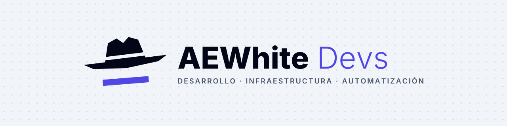
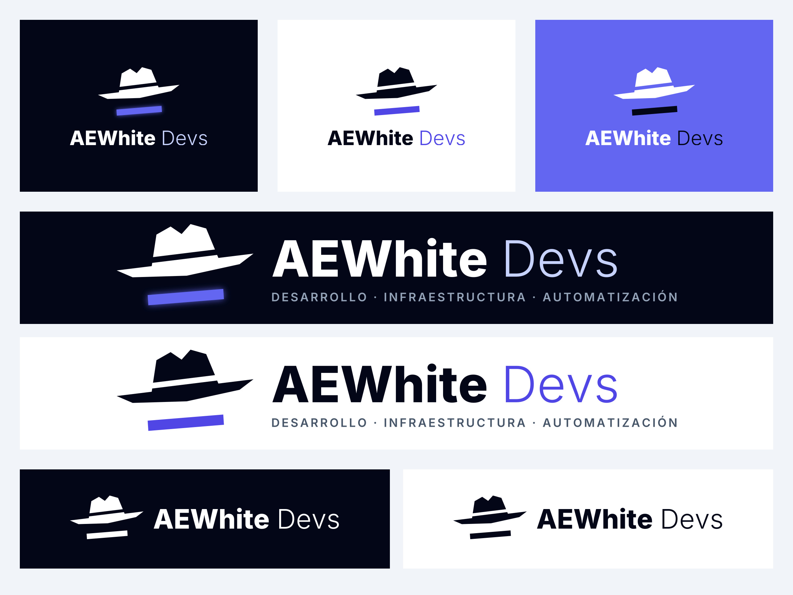

<picture>
  <source media="(prefers-color-scheme: dark)" srcset="./github/readme_banner_oscuro.png">
  
</picture>

# AEWhite Devs · Brand assets

Logos, iconos e imágenes oficiales de **AEWhite Devs** listos para usar en webs, perfiles, repositorios y tiendas de apps.



## Qué hay aquí

| Carpeta | Contenido |
|---|---|
| `logo/` | Símbolo, horizontal, vertical, con lema y solo nombre. Versiones `oscuro` (principal), `claro`, `blanco`, `negro` e `indigo`. SVG + PNG. |
| `iconos/favicon/` | `favicon.ico`, `favicon.svg`, PNG, `apple-touch-icon`, `site.webmanifest` y el código para el `<head>`. |
| `iconos/android/` | Ícono adaptable (fondo, frente y monocromo) en todos los mipmaps + XML. |
| `iconos/ios/` | `AppIcon.appiconset` listo para Xcode. |
| `github/` | Avatar, vista previa para repos (Settings → Social preview), banners de README y badges. |
| `redes/` | Fotos de perfil y portadas: LinkedIn, X, YouTube, Discord, Facebook e Instagram. |
| `web/` | Imagen para compartir enlaces (Open Graph 1200×630) y pantalla de carga. |
| `tiendas/` | Google Play (icono, gráfico destacado, encabezado) y App Store (icono). |

## Usar desde una web

```html
<!-- Logo horizontal para fondo oscuro -->


<!-- Favicon -->
<link rel="icon" href="https://cdn.jsdelivr.net/gh/AEWhite-Devs/brand-assets@main/iconos/favicon/favicon.svg" type="image/svg+xml">
```

En un README de GitHub:

```md

```

## Colores

| Nombre | HEX |
|---|---|
| Noche | `#020617` |
| Pizarra | `#0F172A` |
| Índigo | `#6366F1` |
| Índigo oscuro | `#4F46E5` |
| Lavanda | `#C7D2FE` |
| Gris | `#94A3B8` |
| Niebla | `#F1F5F9` |
| Blanco | `#FFFFFF` |

**Tipografía:** Inter (ExtraBold para *AEWhite*, Light para *Devs*). Los SVG ya traen el texto convertido a trazos.

## Reglas rápidas

- Usa los archivos tal cual: no cambies colores, no estires ni enderezes el sombrero.
- Versión `oscuro` sobre fondos oscuros, `claro` sobre fondos claros.
- Deja aire alrededor del logo (al menos la mitad de la altura del símbolo).
- Por debajo de 120 px de ancho, usa solo el símbolo o el icono.

---

© AEWhite Devs LLC. El nombre y el logo de AEWhite Devs son marcas de AEWhite Devs LLC.
Puedes usarlos para enlazar o referirte a nosotros; para otros usos escríbenos a admin@aewhitedevs.com.
